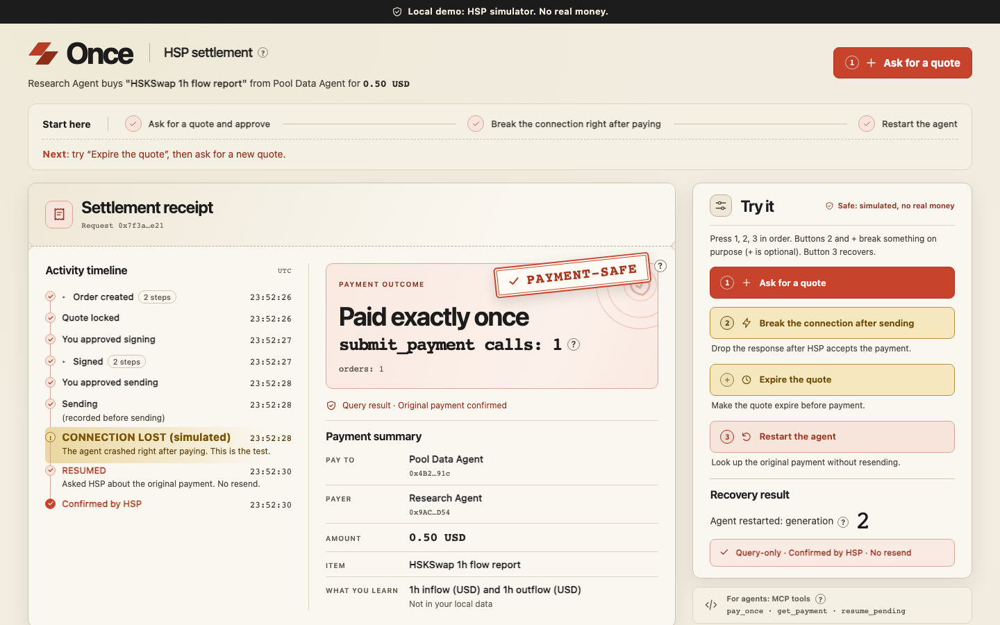
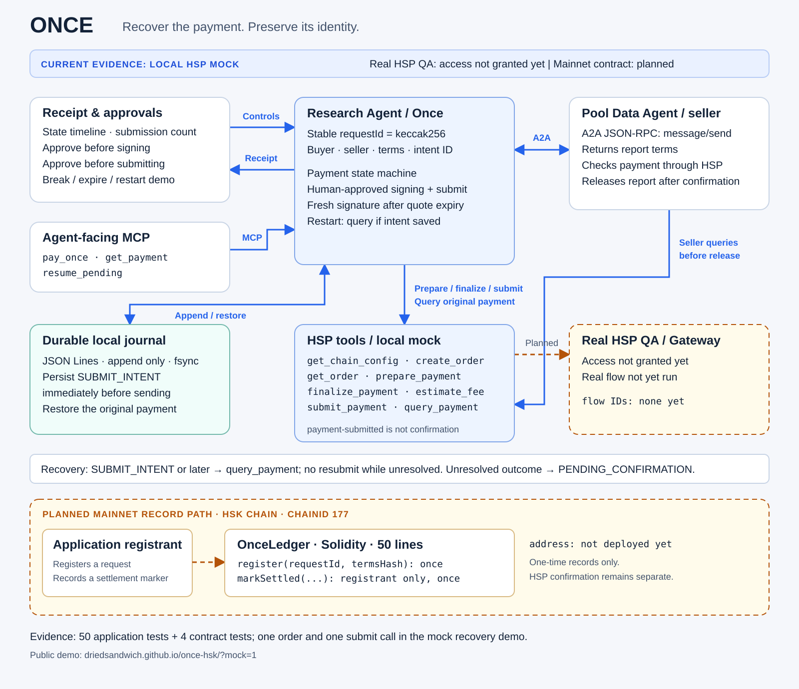

# Once: a lost reply should not become a second payment

Once is a TypeScript payment component for agent-to-agent purchases through the HSP payment gateway's MCP tools. It writes each step to a durable journal before acting, so that after a crash or a lost response it resumes the original payment by querying it instead of creating a new order.

Built for the HSK Chain Horizon Hackathon (track: Agent Payments & A2A Settlement). The demo is a Research Agent buying an "HSKSwap 1h flow report" from a Pool Data Agent for 0.50 USD. Recovery is demonstrated against a local HSP mock. No real HSP endpoint has been used and no real money moves.





## What is new

- **A stable identity for each payment.** `requestId` is the keccak256 hash of the buyer, the seller, the terms (merchant, item, USD amount, cart expiry, network, token, protocol) and an intent identifier. Retries and restarts of the same request keep the same `requestId`.
- **A journal written before every action.** Each request has one append-only JSON Lines file. Every line is flushed with fsync, and the file is locked per request (`flock(1)` on Linux, an `O_EXCL` lock file on other platforms). `SUBMIT_INTENT` is written and synced immediately before `submit_payment`.
- **Recovery by query.** If a restart finds `SUBMIT_INTENT` or a later state, the first call is `query_payment` on the original flow. Once does not resubmit while the outcome is unresolved. It prepares a new quote only when the old quote has expired and the gateway's answer shows the old one was never accepted. Payments still unresolved after 10 minutes of polling (every 15 seconds) end as `PENDING_CONFIRMATION` and resume on the next run.
- **Two human approvals.** The user approves before signing and again before submission. Declining stops the run.
- **Quote expiry.** An expired quote (5 minutes in the mock) sends the flow back to `prepare_payment` with a fresh signature and fresh approvals. If the gateway rejects the expired authorization (code 30043), only the fresh signature is accepted.
- **Settlement checked by the seller.** The Pool Data Agent answers A2A JSON-RPC `message/send` and releases the report only after its verifier confirms the payment. In the demo, the verifier asks HSP's `query_payment` for the original flow.
- **MCP tools for other agents.** `pay_once`, `get_payment` and `resume_pending` (see "MCP server" below).
- **OnceLedger.** `contracts/OnceLedger.sol` (50 lines) accepts one `register(requestId, termsHash)` per request and one `markSettled(requestId, settlementHash)` by the registrant. It is a record. It does not by itself make HSP transfers exactly-once.

Payment states:

```text
NEW → ORDER_CREATED → PREPARED → APPROVED_SIGN
→ SIGNED → FINALIZED → APPROVED_SUBMIT
→ SUBMIT_INTENT → SUBMITTED
→ CONFIRMED / FAILED / PENDING_CONFIRMATION
```

`FINALIZED` is a step before submission, not a settlement confirmation.

The HSP client requires all eight HSP MCP tools (`get_chain_config`, `create_order`, `get_order`, `prepare_payment`, `finalize_payment`, `estimate_fee`, `submit_payment`, `query_payment`) and refuses to start a payment if one is missing. The payment flow itself calls six of them; the mock also serves `estimate_fee` and `get_order`.

## Run it

Requirements: Node.js 22 (`.nvmrc` pins 22.22.0) and npm 10 (`packageManager` is npm@10.9.4). No keys, tokens or `.env` file.

```sh
nvm use                   # or any Node 22.x
npm ci --ignore-scripts
npm run check             # TypeScript
npm test                  # Vitest (50 tests), then Hardhat (4 contract tests)
npm run demo:crash        # kills the payer right after the mock accepts; a new process recovers by query
npm run demo:server       # screen and HTTP API on http://127.0.0.1:3100/
```

`npm run demo:crash` prints its labels in Japanese.

`npm run demo:server` binds to 127.0.0.1 (`PORT` changes the port, default 3100) and serves the screen at `http://127.0.0.1:3100/`. On the screen: **Ask for a quote**, approve signing, then press **Break the connection after sending** before approving the send. The history stops at "Sending". Press **Restart the agent**: the original payment is found by query, and the receipt shows one `submit_payment` call. **Expire the quote** shows the expiry path.

| Endpoint | What it does |
| --- | --- |
| `POST /api/quote` `{requiredFields?, local?, intentNonce?}` | Asks the seller for terms and decides whether to buy. If it buys, the payment starts and stops at the first approval: an order and a quote exist, nothing is signed or sent. |
| `POST /api/approve` `{requestId, stage: "sign" \| "submit", approve, approvalId?}` | Answers the approval that is waiting. An out-of-date `approvalId` gets 409. |
| `POST /api/fault` `{kind: "drop-after-submit" \| "expire-quote"}` | Arms one fault in the mock HSP for the next matching call. |
| `POST /api/restart` | Simulates a crash of the paying process and resumes from the journal. |
| `GET /api/state` | Requests, waiting approvals, and the mock HSP's own counts (`submitPaymentCalls`, `accepted`, `orders`). |
| `GET /api/events` | Server-Sent Events (`snapshot`, `quote`, `state`, `approval`, `fault`, `restart`, `run-error`). |
| `POST /api/deliver` `{requestId}` | Tells the seller the payment is done; the seller checks with HSP before returning the report. |

POST bodies must be `application/json`. The `Host` header must be `127.0.0.1:<port>` or `localhost:<port>`, and requests from another browser origin get 403.

To look at the screen without any server, serve `web/` as static files and open it with `?mock=1`. Everything then runs in the browser with no API calls:

```sh
python3 -m http.server 8000 --bind 127.0.0.1 --directory web
# then open http://127.0.0.1:8000/?mock=1
```

### MCP server

```sh
ONCE_API_MODULE=./path/to/adapter.ts npm run mcp            # stdio
ONCE_API_MODULE=./path/to/adapter.ts npm run mcp -- http    # Streamable HTTP on http://127.0.0.1:3002/mcp
```

`ONCE_API_MODULE` must point to a module that exports `payOnceApi` (`payOnce`, `get`, `resumeAll`). This repository does not ship a ready adapter that connects the MCP server to a running payment engine: the only module that exports `payOnceApi` is the test stub `test/support/fixtures.ts`. `createPayOnceApi` in `src/payOnceApi.ts` is the building block for a real adapter.

### Seller on its own

```sh
PAY_TO=0xYourPublicAddress npm run seller    # A2A JSON-RPC on http://127.0.0.1:3001/a2a
```

Without `ONCE_VERIFIER` (a module exporting `verifyPayment`), every payment check returns false and the report is never released.

### Real HSP (not exercised)

The demo server can point at another HSP endpoint through `ONCE_HSP_URL`, `ONCE_ASSET_NETWORK`, `ONCE_ASSET_CHAIN_ID`, `ONCE_ASSET_CONTRACT` and `ONCE_ASSET_COIN`. A URL that is not loopback also needs `ONCE_ALLOW_EXTERNAL_HSP=1`. This path has only been tested against a second local mock. The real HSP QA endpoint has not been used.

## Tests

`npm test` runs `npm run test:ts` (Vitest) and then `npm run test:ledger` (Hardhat).

- Vitest, 50 tests:
  - `test/payOnce.test.ts` (29), including: a crash after each of the 10 success-path states, a dropped reply after acceptance, an HTTP timeout during a delayed submit, quote expiry during approval, gateway code 30043, two concurrent clients on one journal, polling and the 10-minute `PENDING_CONFIRMATION`, `FAILED` kept across a crash, explicit approvals, Permit2 pass-through, a missing tool, an incomplete journal tail, a lost `create_order` response, and the `requestId` inputs.
  - `test/demo.test.ts` (9), including: the demo endpoints end to end, the expiry path, declined and cancelled approvals, loopback-only binding, a configured second mock HSP, and a check that the signing key never reaches the journal, the state or the event stream.
  - `test/seller.test.ts` (6), `test/buyer.test.ts` (4), `test/mcp.test.ts` (2: Streamable HTTP and stdio).
- Hardhat, 4 tests: `contracts-test/OnceLedger.cjs`.

Last full run: 2026-11-27, 50 + 4 passing. All payment tests run against the local mock HSP.

## Status

| Item | Status |
| --- | --- |
| OnceLedger on HSK Chain mainnet (chainId 177) | Planned (not deployed yet) |
| Payment flow against the real HSP QA endpoint | Not yet run (QA access requested, not granted yet) |
| Demo video | https://youtu.be/XTicM3n1Rkg |
| Public demo | https://driedsandwich.github.io/once-hsk/?mock=1 (runs in the browser, no backend, no real funds) |

Not verified against a real gateway:

- How a real gateway answers for an authorization it never accepted. The function that recognises such an answer (`isDefinitivelyAbsent`) is implemented for the mock only. Without it, an unresolved submission stays pending instead of being retried.
- The exact response envelope, fee, payload and mandate fields, and the concrete Permit2 typed data.
- Recovery when the `create_order` response is lost before any `flow_id` is known: Once stops and shows the cart ID.
- Distributed storage and physical power loss.

## Safety notes

- The demo HSP is a local mock by default, and the screen says "Safe: simulated, no real money".
- `npm run demo:server` signs with a throw-away key generated in memory at start-up. It reads no key from the environment and never writes or logs the key.
- The local HTTP endpoints (demo, MCP over HTTP, seller) bind to 127.0.0.1. The demo server and the MCP HTTP server also check the `Host` and `Origin` headers; the seller does not. None of them has authentication, so any local process can call them. Do not expose them to a network.
- `ONCE_API_MODULE` and `ONCE_VERIFIER` load and run the module at the given path. Point them only at code you trust.
- The report sold in the demo holds sample values, not real market data.
- Once and OnceLedger have not been audited.

## Repository layout

| Path | Contents |
| --- | --- |
| `src/payOnce.ts` | Payment state machine |
| `src/store.ts` | Journal (append, fsync, per-request lock) |
| `src/hsp/` | HSP MCP client, types and the local mock |
| `src/payOnceApi.ts` | Adapter from `PayIntent` to the state machine |
| `src/seller/`, `src/buyer/` | Pool Data Agent (A2A) and the buyer's purchase decision |
| `src/mcp/` | MCP server and its CLI |
| `src/demo/server.ts` | Demo server (127.0.0.1 only) |
| `contracts/`, `contracts-test/` | OnceLedger and its Hardhat tests |
| `scripts/` | `demo-crash` and a sample intent |
| `test/` | Vitest tests |
| `web/` | Screen (HTML, CSS and JavaScript; no build step) |

## License

MIT License. Copyright (c) 2026 Shintaku Era. See [LICENSE](LICENSE).
